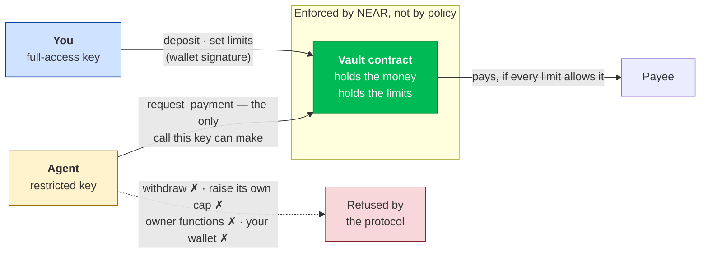
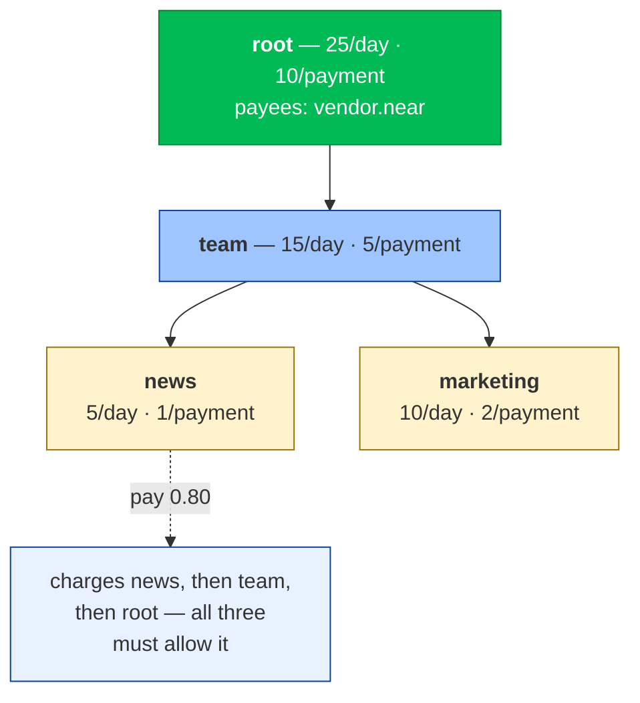
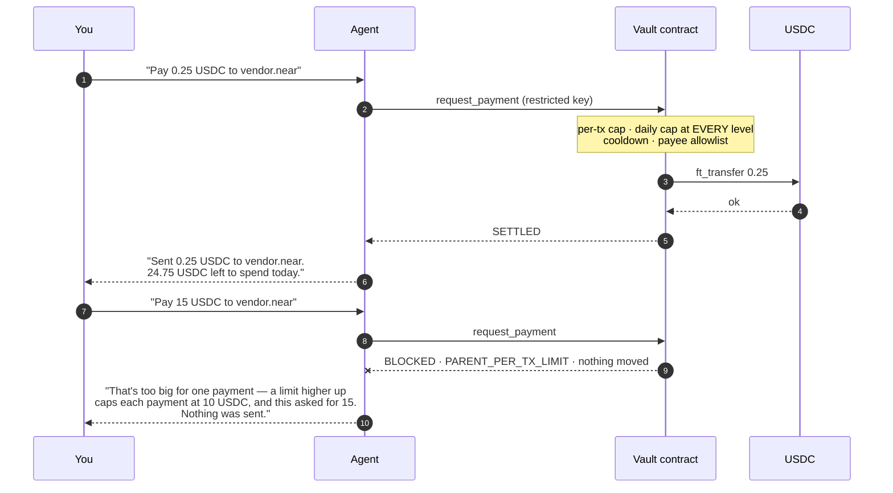
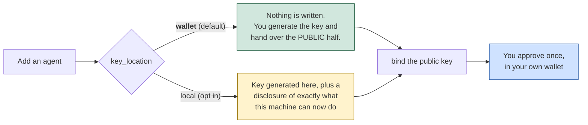

<div align="center">

# Float

### A spending budget an AI agent cannot talk its way out of

**Give an agent money without giving it your wallet.**

[](https://usefloat.xyz)
[](https://www.npmjs.com/package/@floatonnear/mcp)
[](https://www.npmjs.com/package/@floatonnear/create-float)


[**usefloat.xyz**](https://usefloat.xyz) · factory [`usefloat.near`](https://nearblocks.io/address/usefloat.near) · `npx -y @floatonnear/mcp`

**Mainnet live** · **actively developed** · MIT · [limitations stated below](#known-limitations), not buried

</div>

---

## The problem

Agent frameworks hand the agent a wallet key and a budget in a config file, then
hope it behaves. Both halves are weak. **A budget the agent can read is a budget
it can rationalise around** — it is text in a context window, subject to every
instruction that arrives after it. And **a key the agent holds is a key it can
spend**, on anything, to anyone, however the limit was worded.

So the limit is a suggestion, and the only thing enforcing it is the model's
good behaviour on a bad day.

Float moves both out of reach. The agent gets a NEAR **function-call key scoped
to one method on one contract**. The money lives in the contract. The limits live
in the contract. The agent cannot reach either — and no prompt, jailbreak or
confused-deputy trick changes that, because the refusal happens in the protocol
before any contract code runs.



Those four `✗` are not checks Float performs. They are the key's `method_names`
and `receiver_id`, enforced by NEAR before the contract is even reached.
**Verify it on any live vault:**

```bash
near account list-keys test015-near.usefloat.near network-config mainnet
# -> receiver_id: the vault itself   method_names: ["request_payment"]
```

---

## Budgets are a tree, and that is the interesting part

A flat per-agent cap cannot express *"my agents may spend 25/day **between
them**"*. Float's budgets are a tree, and a payment is charged against **every
level above it**.



So a vault-wide ceiling holds **even when one agent's own cap looks free** — and
when that happens the contract tells you which level stopped it:

| it answers | meaning |
|---|---|
| `DAILY_BUDGET` | this agent's own cap is spent |
| **`PARENT_DAILY_BUDGET`** | **a sibling drained the shared pool — this agent's own cap still shows as available** |
| `PER_TX_LIMIT` | one payment too large; splitting may still hit the daily cap |
| `RECIPIENT_NOT_ALLOWED` | payee is not on the allowlist |

**41 distinct codes.** `PARENT_*` existing as its own answer *is* the hierarchy
being visible in the error — a flat model cannot tell you that.

Depth is capped at **4** and tokens per node at **4**, so the per-payment walk is
a fixed-length loop rather than an unbounded traversal.

---

## A payment, end to end



A refusal is a **returned value**, not an exception, and nothing moves. The agent
pays its own gas from a NEP-611 gas key (**0.000866 NEAR** per payment, measured),
so the vault's only per-payment cost is the single yoctoNEAR a NEP-141 transfer
requires.

---

## It speaks like a product, not like a contract

Every user-facing tool returns the sentence already built, with the real numbers
in it — so a coding agent never has to narrate machinery at you.

```json
{
  "say": "Sent 0.25 USDC to vendor.near. There's 24.75 USDC left to spend today.",
  "next_step": null,
  "money_moved": true,
  "technical": { "status": "SETTLED", "reason_code": null }
}
```

`money_moved` is the one fact a person cannot infer and must never have to guess.
Reason codes stay under `technical` — precise, and not what anyone wants first.

---

## Secure by default: an agent key is never created without asking

The convenient thing is to generate a spending key on the developer's machine.
Float will — **only if you ask**.



Pass `local` and it says so, in the same breath as the bound:

> **WORTH BEING CLEAR: this machine will now hold a spending key for your vault.**
> Once you approve, it can spend up to 5 USDC a day, 1 at a time, **WITHOUT asking
> you again.** It cannot withdraw your money. It cannot change any limit, including
> its own. It cannot do anything else an owner can. That is **NEAR enforcing it,
> not a rule I follow.**

---

## The agent proposes. The human signs.

Every `vault_plan_*` tool returns an **unsigned payload** and `money_moved: false`.
The MCP server cannot sign a policy change — it holds only the restricted agent
key, which cannot reach an owner method at all.

> So when an agent says *"I've raised your cap"*, it is wrong. It built a payload.
> Nothing changed until you approved it.

### Three doors, and the difference is structural

Browser wallets **ignore `signerId`** and silently sign as the connected account
(measured across Meteor, Intear and the CLI connector). So anything needing the
**vault** as signer can never be a browser action — which is why teardown is a CLI
job, permanently.

| Door | Create | Pay | Change policy | Sign *as the vault* |
|---|:---:|:---:|:---:|:---:|
| **Browser** `usefloat.xyz` | ✅ | — | ✅ approve | ✗ *ever* |
| **MCP** (the agent) | ✅ link | ✅ | ✗ propose only | ✗ |
| **CLI** (key on disk) | ✅ | — | ✅ | ✅ |

---

## Try it

**1 — Install the MCP server.** Copy this into your MCP client's config and
restart it. Leave `NEAR_VAULT_CONTRACT` empty — you get the value in step 2.
27 tools; reads and planning need no key at all.

```json
{
  "mcpServers": {
    "float": {
      "command": "npx",
      "args": ["-y", "@floatonnear/mcp"],
      "env": {
        "NEAR_VAULT_NETWORK": "mainnet",
        "NEAR_VAULT_FACTORY": "usefloat.near",
        "NEAR_VAULT_CONTRACT": "",
        "NEAR_VAULT_TOKEN": "17208628f84f5d6ad33f0da3bbbeb27ffcb398eac501a31bd6ad2011e36133a1",
        "NEAR_VAULT_TOKEN_DECIMALS": "6",
        "NEAR_VAULT_AGENT_KEYS": "/absolute/path/to/.float/agent-keys.json"
      }
    }
  }
}
```

<details>
<summary><b>Three settings that bite — worth 30 seconds before you start</b></summary>

<br/>

**Use an absolute path for `NEAR_VAULT_AGENT_KEYS`.** A relative one resolves
against whatever directory your client was launched from, so one config silently
becomes a different keyring per project — and an agent you created in one
folder is invisible from another.

**The network must match your vault.** A mainnet vault read by a testnet client
does not error. It reports your vault as *missing*, which reads as a broken
product rather than a wrong setting.

**Don't set `NEAR_VAULT_RPC_URL` unless you mean it.** It overrides the endpoint
for the network you configured, so a leftover testnet URL sends mainnet
questions to testnet and the answers come back *wrong* rather than failing.

</details>

**2 — Create a vault.** Ask the agent — `vault_create` builds the link for you —
or open [usefloat.xyz](https://usefloat.xyz) directly.
One wallet signature; the factory creates the account, deploys the contract,
installs your key as full-access on the vault, binds the agent's gas key,
initialises the budget tree, **and registers the vault on the token so you can
fund it**. The address is derived from your account
(`alice.near` → `alice-near.usefloat.near`), so nobody can squat it.

About **3.66839 NEAR** with an agent (**3.54839** without) — almost all of it
refundable storage stake your vault holds, not a fee. Quote `vault_create`'s own
`totalRequiredNear`, never a remembered number.

**3 — Fund it.** Send USDC to the vault address.

**4 — Give an agent a budget.** `vault_add_role` returns a payload you approve:

> *"Add an agent called research with a 5 USDC daily cap and 1 per payment"*

**5 — Pay, and get refused.**

```
"Pay 0.25 USDC to vendor.near for API credits"   -> SETTLED, money moved
"Pay 15 USDC to vendor.near"                     -> PARENT_PER_TX_LIMIT, nothing moved
```

**Winding down returns everything** — tokens, the agent's gas balance, and the
storage deposit. The dry run prints exactly what comes back, first:

```bash
npx -p @floatonnear/create-float float-exit --owner <you> --vault <vault> --dry-run
```

---

## Not using MCP? Copy the guide.

Everything the agent is told lives in one file — refusal codes and what to do
about each, the teardown ORDER (which decides whether an agent's gas is
recovered or **burned**), which flows need a human signature, and how to speak
to a person rather than narrate a contract.

**Point your agent at this URL:**

```
https://usefloat.xyz/skill.md
```

Served as `text/plain`, so an agent fetching it gets the bytes rather than a
rendered page. Kept byte-identical to this repo by a gate check
(`scripts/check-live-docs.mjs`), which fails the build if the deployed copy
drifts — so the short link and the source cannot disagree.

| Your setup | What to do |
|---|---|
| **MCP client** | nothing — it is already served as the resource `float://skill` |
| **Claude Code / skills** | `curl -o .claude/skills/float/SKILL.md https://usefloat.xyz/skill.md` |
| **Any other agent** | fetch the URL, or paste the file into the system prompt |

> **Fetch it raw; don't read it through a summariser.** The file is ~43 KB. A
> tool that summarises web pages hands you a lossy précis in which the exact
> commands may be missing or altered — the file says so in its own header.

Mirrors, if you prefer them: [`app.usefloat.xyz/skill.md`](https://app.usefloat.xyz/skill.md)
and the [raw file on GitHub](https://raw.githubusercontent.com/bshuaibu1/float-near/main/SKILL.md).

---

## What a judge can verify without asking us

| Claim | How to check |
|---|---|
| Factory live on mainnet | `near view usefloat.near get_config` → owner, mainnet, not paused |
| A real vault exists | `near view test015-near.usefloat.near get_config` → `owner: test015.near`, `network: mainnet`, `node_count` ≥ 1 (**7** as written — it grows as agents are added, so a different number is not a mismatch) |
| **The agent key is restricted** | its access key shows `receiver_id` = the vault and `method_names: ["request_payment"]` |
| Vault is registered on USDC | `storage_balance_of` is non-null — the factory does this in the creation transaction |
| Packages published | [`@floatonnear/mcp`](https://www.npmjs.com/package/@floatonnear/mcp) · [`create-float`](https://www.npmjs.com/package/@floatonnear/create-float) · [`float-adapter`](https://www.npmjs.com/package/@floatonnear/float-adapter) |
| It is tested | **1,424 tests** — 440 MCP + 262 CLI + 246 dashboard + 230 adapter + 165 vault + 45 sandbox + 36 factory; `node scripts/verify-all.mjs` runs **42** gated checks, 12 of them mutation suites. CI runs all of it: [](https://github.com/bshuaibu1/float-near/actions/workflows/verify.yml) |
| Teardown really refunds | `float-exit --dry-run` on any vault, then compare against the chain |

A real 0.25 USDC payment has settled on mainnet and charged both the agent's node
and the root; a 15 USDC payment was refused `PARENT_PER_TX_LIMIT` and moved
nothing.

---

## Known limitations

We would rather you read these here than discover them.

- **`derive_prefix` is not injective.** `a.b.near` and `a-b.near` both derive
  `a-b-near`; first to create holds it. Unfixable while addresses stay readable.
- **Labelled vaults are not found by lookup.** The dashboard derives the
  *unlabelled* address; a vault created with `?label=ops` must be addressed
  explicitly.
- **Cross-chain quotes are EXACT_OUTPUT.** `amount` is what the payee *receives*;
  the vault is charged more (~1.5% at 0.50 USDC, ~3.5% at 0.10) and the budget is
  charged the larger figure, so small cross-chain payments are disproportionately
  expensive. Implemented and quote-signed; **not yet demonstrated on mainnet.**
- **Refused payments are not stored on-chain** — storing them would let anyone
  inflate your storage bill. `vault_history` shows settled and failed, and says so.
- **No mainnet global contract**, so each vault carries its own code (~2.99 NEAR of
  refundable stake).
- **Six contract capabilities have no interface yet** — ownership transfer, node
  removal, stuck-payment sweep, NEAR-denominated caps. Listed in `FLOAT.md` §5, and
  the build fails if a seventh appears.
- **A function-call key cannot sign `DeleteAccount`**, so anything that funds an
  account such a key controls is a permanent loss. That is why agents are
  **virtual** — a key installed on the vault, not a sub-account.

---

## Hackathon disclosures

Stated here because the rules ask for them, and because a judge finding any of
it unstated is worse than reading it.

**All of this was built in the window.** First commit **2026-10-26**, after the
2026-10-19 announcement; 589 commits at the submitted tip, none before. There is
no pre-hackathon baseline to separate out, and no earlier version of this code —
which is why there is no `pre-hackathon` tag, only the one below.

**The judged boundary is a tag** *(Q-003)*. Development ended
**2026-11-14T23:59:00Z**, and
[`hackathon-submission`](https://github.com/bshuaibu1/float-near/tree/hackathon-submission)
marks the exact commit submitted inside it: `a2a927c`, pushed 2026-11-14 20:46
UTC. **Everything judged is at or before that tag.**

Commits on `main` dated **2026-11-15 or later are after the deadline and claim
no credit** — diff them yourself against the tag. They are fixes and tooling
only, and they exist because the submitted tip had six failing tests and a
README link to a `DEMO.md` that had been untracked, which is a poor thing to
hand a judge. Specifically: the first CI this repo has ever had; a revert of an
unreleased contract change off `main` (kept on `feature/add-role-parent`) so
the shipped wasm again matches both its source and the deployed mainnet vault;
re-tracking `DEMO.md`; and correcting stale figures. **No feature was added
after the deadline**, and the contract is byte-identical to the submitted one —
`packages/create-float/res/vault.wasm` still hashes to
`Fqep3KLeorhvQK38gXt6A7x2PEj8nnjy6CyZeo3DHVwM`, which is what
`test015-near.usefloat.near` runs.

**There is a sibling product on another chain** *(Q-002)*. The same team ships
[`@usefloat/mcp`](https://www.npmjs.com/package/@usefloat/mcp) — a Float for
Solana, submitted to a different hackathon. **It shares no code with this
repository.** Different chain, different contract, different package scope
(`@usefloat` vs `@floatonnear`). The hierarchical budget tree, the vault
contract, the function-call-key restriction and everything in this repo were
written here, for NEAR. Only the brand and the general idea — give an agent a
budget it cannot exceed — are common.

**This was built with heavy AI assistance** *(Q-005)*. Most of the code,
tests and documentation were written with Claude Code, under human direction
and review. The commit history shows it: commits are co-authored and the
reasoning is in the comments rather than hidden. That reasoning is deliberate —
several comments name the exact measurement or incident that produced a line,
because this codebase's hardest bugs were ones where the test passed and the
behaviour was still wrong.

**No other libraries or templates beyond the dependencies in
`package.json` / `Cargo.toml`.** The contract is written from scratch on
`near-sdk`; the MCP server on the official `@modelcontextprotocol/sdk`.

---

## Docs

Read them in this order. **If any two disagree, `STATE.md` wins** — it is the
only one re-stamped against a commit, and the build fails when that stamp goes
stale.

| File | What it is for | Read it when |
|---|---|---|
| [`STATE.md`](STATE.md) | What is true *right now*: live addresses, balances, what is broken. **Authoritative over every other doc.** | Always first |
| [`DECISIONS.md`](DECISIONS.md) | Settled calls, each naming **the rejected alternative** and why | Before proposing a change — it may already be a rejected row |
| [`ARCHITECTURE.md`](ARCHITECTURE.md) | The parts, the trust boundaries, where the vault's code comes from | You want to know how it fits together |
| [`FLOAT.md`](FLOAT.md) | Every capability and the full lifecycle, create to teardown | You want the exhaustive list |
| [`SKILL.md`](SKILL.md) | What the agent itself is told — refusal codes, teardown order, how to speak | You are wiring up an agent |
| [`DEMO.md`](DEMO.md) | 90-second demo script with exact commands | You want to see it work |

## Development

```bash
node scripts/verify-all.mjs     # THE gate: 42 checks
```

Not `npm test`. Every check asserts an exit code **and** a must-appear pattern
**and** a must-not-appear pattern, because *a check that cannot run prints nothing
and exits 0*.

Build the contract with `cargo near build`, never plain `cargo build` — a plain
build swaps in near-sdk's pure-Rust fallbacks, so every panic becomes "unreachable
opcode" and reason codes vanish silently, with tests still passing.

<div align="center">

**Built at NEAR HACKATHON 2026** · [usefloat.xyz](https://usefloat.xyz)

</div>
